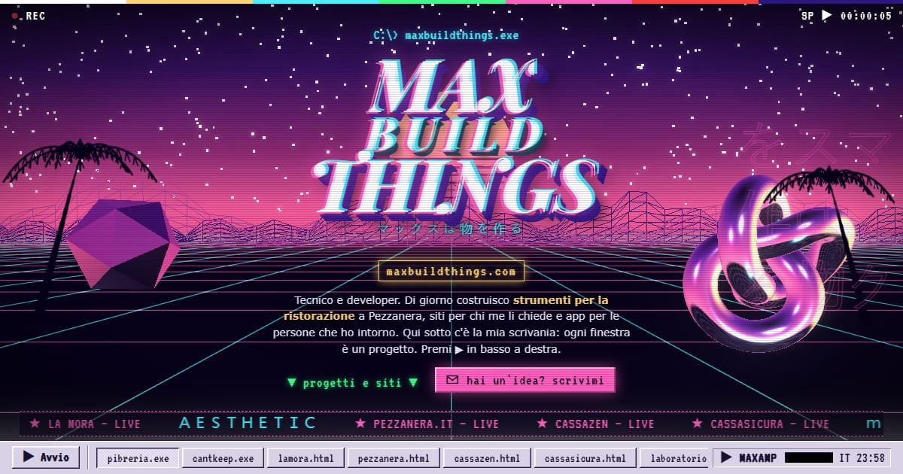

# maxbuildthings

Il sito vetrina di Max: un desktop finto in stile Windows 98, con l'estetica vaporwave di fine anni '90 e una finestra per ogni progetto.

**→ [maxbuildthings.com](https://maxbuildthings.com)**



## Cosa c'è dentro
- Una pagina sola (`index.html`), con CSS e JS scritti a mano e gli screenshot incorporati. Niente framework e niente build.
- Una scena WebGL di oggetti cromati con bloom, fatta con Three.js r128.
- Un player lo-fi generativo con la Web Audio API: tre tracce originali sintetizzate nel browser, e i visual che reagiscono all'audio.
- Finestre che si trascinano, si riducono a icona e si chiudono, con la barra delle applicazioni e il menu Avvio. Ci sono anche la schermata BIOS, lo screensaver e qualche easter egg (prova il Konami code).
- Nessuna richiesta a domini terzi, quindi niente cookie e niente tracker: font e librerie li serve il sito stesso, e la CSP in `vercel.json` lo garantisce.

## Provarlo in locale
```
cd strumenti && npm install && cd ..
node strumenti/serve.mjs        # http://localhost:5182, con le stesse intestazioni di Vercel
node strumenti/controlla.mjs    # controlla errori, domini terzi, font, scena 3D e 404
```

## Contatti
massi.cc@proton.me: rispondo io, non un modulo.
